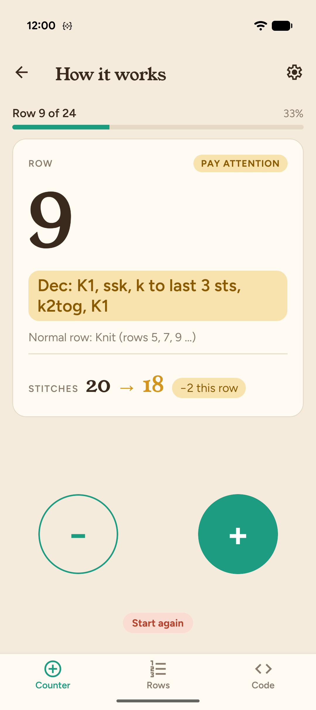
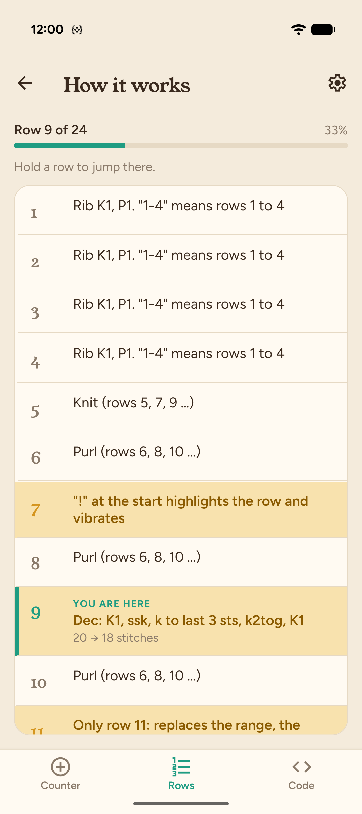
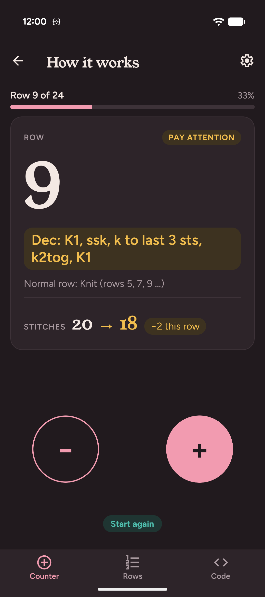
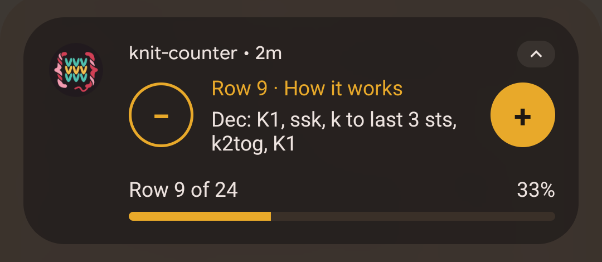
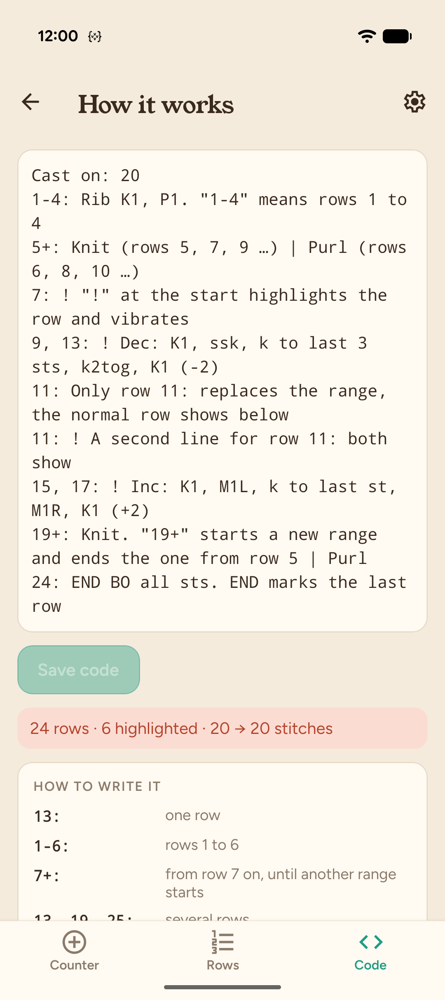
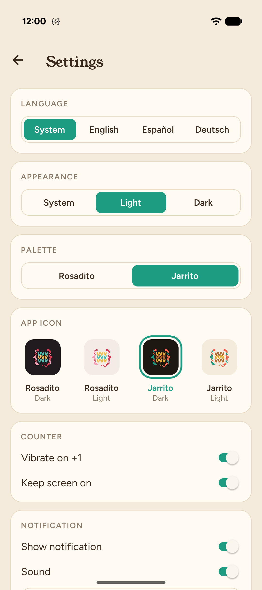

**English** · [Deutsch](README.de.md) · [Español](README.es.md)

# knit-counter 🧶

A row counter for knitting and crochet that shows you what to do in the row you're on.

<p align="center">
  
  
  
</p>

<p align="center">
  
</p>

## Why I made this

While working on a knitting project, I always had the pattern open in one app, a row counter in another, and usually a video playing on top. Switching back and forth all the time made it really easy to lose track of where I was.

I couldn't find an app that did all of this together, so I made my own little one that keeps everything in one place:

- it shows me what to do in the row I'm on
- it reminds me when an increase, decrease or other special row is coming
- and it has a notification with −/+ buttons, so I can keep watching my show and still count my rows

I made it just for me, for knitting and crochet, and it's honestly been really fun to build 💛

## Features

- **The instruction for your current row**, big and readable. When a special row replaces the normal one, the normal row is shown underneath.
- **Highlighted rows** for increases, decreases and anything else you shouldn't miss. The phone vibrates when you reach one.
- **Stitch count** per row, including how many stitches you gain or lose.
- **Row list** with all rows of the pattern. Hold a row to jump there.
- **Pattern code**: write your pattern once in a short, simple format (see below). The app checks it and tells you about gaps, overlaps and mistakes.
- **Notification with −/+ buttons** and a progress bar, so you can count rows without leaving the app you're in.
- **Projects with several patterns**, e.g. front, back and sleeves of a sweater.
- **Two color palettes** (Rosadito and Jarrito), light and dark mode, four app icons, and a splash screen that matches the palette.
- **English, Spanish and German.**
- Everything is saved on the phone. No account, no internet needed.

<p align="center">
  
  
</p>

## The pattern code

Each line starts with the rows it's for, then a colon, then the instruction. This is the "How it works" example that comes with the app (the one in the screenshots above):

```
Cast on: 20
1-4: Rib K1, P1. "1-4" means rows 1 to 4
5+: Knit (rows 5, 7, 9 …) | Purl (rows 6, 8, 10 …)
7: ! "!" at the start highlights the row and vibrates
9, 13: ! Dec: K1, ssk, k to last 3 sts, k2tog, K1 (-2)
11: Only row 11: replaces the range, the normal row shows below
11: ! A second line for row 11: both show
15, 17: ! Inc: K1, M1L, k to last st, M1R, K1 (+2)
19+: Knit. "19+" starts a new range and ends the one from row 5 | Purl
24: END BO all sts. END marks the last row
```

| Code           | Meaning                                        |
| -------------- | ---------------------------------------------- |
| `13:`          | one row                                        |
| `1-6:`         | rows 1 to 6                                    |
| `7+:`          | from row 7 on, until another range starts      |
| `13, 19, 25:`  | several rows                                   |
| `Knit \| Purl` | alternates row by row, starting with the first |
| `!`            | at the start of the text: highlight the row    |
| `END`          | at the start of the text: the last row         |
| `Cast on: 66`  | starting stitches, shows the stitch count      |
| `(-2)` `(+1)`  | stitches lost or gained on that row            |

A single row (`11:`) wins over a range (`5+:`), so you only write the rows that are different.

**Coming next:** the app will understand knitting abbreviations like `k2tog`, `ssk` or `M1L` (in English, German and Spanish) and count the stitches by itself, and the code editor gets an update.

## Tech

- [Expo](https://expo.dev) SDK 57, React Native 0.86, TypeScript
- Expo Router for navigation
- Zustand with AsyncStorage for saving projects and settings
- i18next and react-i18next for the three languages
- **Own native modules in Kotlin:**
  - `row-notification`: a foreground service with a custom notification layout (RemoteViews), −/+ actions and colors that follow the palette
  - `app-icon`: switches the launcher icon with activity aliases
  - `splash-theme`: sets the splash screen per palette (Android 13+ SplashScreen API)
- **Own config plugins** that generate the icon aliases, the splash themes and `local.properties` during prebuild

The app is built for Android. The native features are Android only.

## Run it yourself

You need Node.js, the Android SDK (e.g. through Android Studio) and a JDK 17 or newer.

```bash
git clone https://github.com/ma981son/knit-counter.git
cd knit-counter
npm install
npx expo run:android
```

This builds a development version and installs it on a connected phone or emulator. For a faster version without the development server:

```bash
npx expo run:android --variant release
```

## License

[MIT](LICENSE) © Maria Fe Sonnenberg
